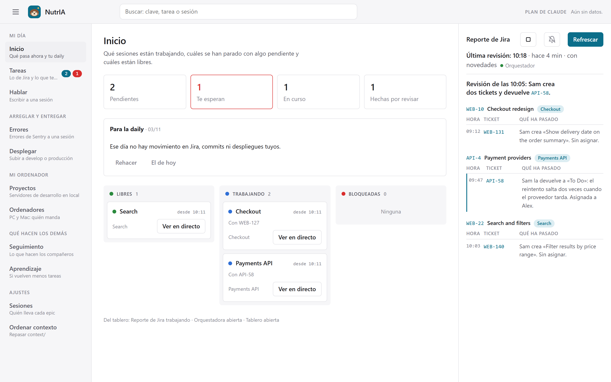
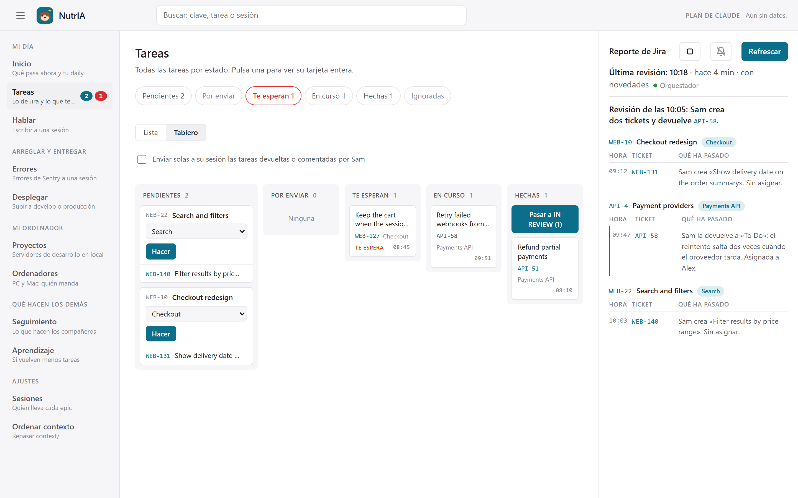
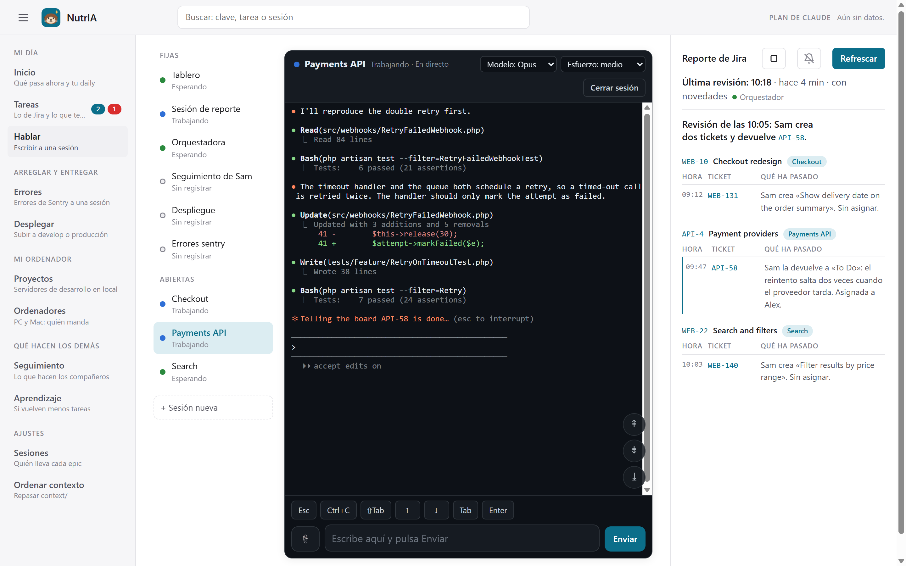
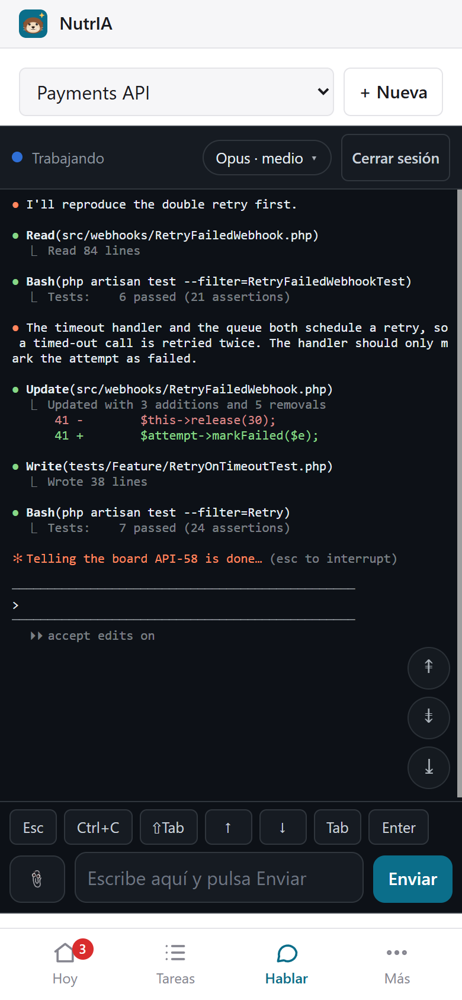

# Dashboard Jira

A local control tower for running several [Claude Code](https://claude.com/claude-code) sessions on a Jira backlog. It reads Jira, turns new and returned tickets into cards, and lets you decide from your desktop or your phone which AI session works on each one.



## Why

When several AI coding sessions work in parallel (one per product area), someone has to watch Jira, decide what goes where, pass each session the ticket and its attachments, and collect the answers. Dashboard Jira does that plumbing. You keep the decisions: nothing is sent to a session until you approve it.

## How it works

1. **A reporter session reads Jira** every few minutes. It publishes a short report and creates a card for each new ticket, each ticket returned from review and each new comment on one of your tickets.
2. **You approve cards** on the board, from the browser or from your phone. Each card goes to the session that owns its epic.

   

3. **An orchestrator session delivers** the approved work, with the ticket's attachments already downloaded. Each session reports back `done`, `partial` or `question`, and you answer from the board.

It also has:
- **a session host**: the fixed sessions (reporter, orchestrator, follow-up, board) and the area sessions run as `claude` processes inside the board's own terminals (`node-pty`). They start by themselves at boot, wake up when work arrives, go to sleep after 30 idle minutes, and the reporter and orchestrator start a fresh conversation every day;
- **Talk** (Hablar): the live terminal of each session, from the desktop or the phone. It has a session list showing who is working, waiting or asleep, a model and effort picker per session, voice notes transcribed locally with Whisper, and replies spoken with Piper;
- **permissions**: a `PreToolUse` hook sends each permission request to the board. Read-only commands and edits inside the workspace are approved on their own, and the rest wait for you on the board;
- **two machines** (optional): a PC and a Mac run the board together. One is in command (it hosts the sessions and talks to Jira) and the other mirrors it. See [Two machines](#two-machines);
- **Projects**: start and stop the local dev servers (database, API, frontends) and see if they answer;
- one-click deploy orders, with the live state of GitHub Actions and AWS CodeDeploy;
- Sentry errors sent to a session with one click;
- push notifications;
- a daily summary of yesterday's work, and an activity summary of beta and production split by person;
- a "Learning" tab that tracks how often work comes back from review;
- the shared `context/` folder kept in sync through git.





Everything runs on your machines: a Node server on `127.0.0.1`, a SQLite file and your Jira API token in a local `.env`. Nothing goes anywhere except your own Jira, and Sentry, GitHub and AWS if you turn them on. The interface is in Spanish.

## Quick start

```bash
git clone https://github.com/Albrodpul/dashboard-jira.git
cd dashboard-jira && npm ci && cd ..
node dashboard-jira/install.js C:/work/acme/board   # creates board.config.json and .env there
# fill in .env (Jira site, email, API token) and board.config.json (projects, root folder)
node C:/work/acme/board/board.js jira-setup        # prints the Jira ids the config needs
node dashboard-jira/install.js C:/work/acme/board   # renders the Claude Code slash commands
node C:/work/acme/board/board.js ensure            # http://127.0.0.1:4747
```

Then run `/resumen-jira` in one Claude Code session and `/orquesta` in another. The full walkthrough is below.

## Requirements

- Node 24 or later. It uses the built-in `node:sqlite`; the only npm dependencies are `@lydell/node-pty`, `@xterm/xterm`, `@xterm/addon-fit` and `ws`, for the session terminals.
- The Claude Code CLI (`claude`). The VS Code extension is optional: sessions can still be opened there.
- A Jira Cloud API token.
- Windows or macOS. What differs between them (processes, paths, keeping the machine awake) lives in `src/core/platform.js`.

## Setting it up at a company

The code is the same everywhere. What changes from one company (one Jira) to another lives in a **workspace folder** you create for it, so you can have one per company and switch by pointing to another folder.

### 1. Clone and install into a new workspace

```bash
git clone https://github.com/Albrodpul/dashboard-jira.git
node dashboard-jira/install.js C:/work/acme/board
```

The first run creates `board.config.json` and `.env` from the examples and stops, because they are empty.

### 2. Jira credentials (`.env`)

Create an API token at <https://id.atlassian.com/manage-profile/security/api-tokens> and fill in:

```dotenv
JIRA_SITE=your-company.atlassian.net
JIRA_EMAIL=you@your-company.com
JIRA_TOKEN=<the token>
```

The `.env` never leaves the workspace folder and is git-ignored.

### 3. Projects and root (`board.config.json`)

Set at least:

- `company`: the company name, used in texts.
- `root`: the folder you open in VS Code, where the Claude Code sessions live. The installer writes the slash commands into `<root>/.claude/commands/`.
- `jira.projects`: the project keys to watch, e.g. `["WEB", "API"]`.

### 4. Let Jira fill in the ids

With the credentials and the projects in place, ask Jira for the rest:

```bash
node C:/work/acme/board/board.js jira-setup WEB-123 "Reviewer Name"
```

- `WEB-123` is any ticket of yours that is in progress. It is used to list the transitions available from that state.
- `"Reviewer Name"` is the person who reviews your work. Their account id is looked up by name.

The output gives you:

| Output | Goes to |
|---|---|
| `me.id`, `me.name` | `jira.me` |
| `reviewerCandidates[].id`, `.name` | `jira.reviewer` (also set `mentions`: how people write their name in comments, e.g. `["@Ana López", "@Ana"]`) |
| `statuses` per project | `statuses.review` (the "in review" state), `statuses.returned` (states a ticket goes back to when the review fails), `statuses.inProgress`, `statuses.closed` |
| `transitionsFrom.transitions[].id` | `jira.transitions.start` / `todo` / `block`, used by `jira-write.js` |

Also set `statuses.rejectLabel`, the label reviewers add when they reject a ticket, if your team uses one. And set `jira.defaultIssueType`, the issue type `jira-write.js create` uses.

### 5. Optional parts

- `followUp`: the follow-up session summarises everyone's activity in beta and in production, split by person. `everyHours` sets how often each environment is summarised (default 1 for beta, 2 for production); either can also be asked for from the board. `people` is the starting directory of known people (`name` and the `accounts` they use); the session adds new colleagues as it finds them. How the summary is built (which database, which table) is written in `templates/commands/seguimiento.md`; adapt it to your platform or leave the list empty.
- `deployProjects`: the projects the Deploy tab offers. Leave it empty if you don't deploy from the board. Each entry can be just a name, or an object with `repo` (`owner/name` on GitHub) and, for projects deployed with AWS CodeDeploy, `codedeploy: { application, develop, production }` (deployment group per environment). With those, the Deploy tab shows the live state of each environment as two steps in order, each with a progress bar: the last GitHub Actions run whose workflow name contains `develop` or `production` (override with `workflows`), counted in completed job steps, then the CodeDeploy deployment, counted in completed lifecycle events per instance. A push notification arrives when one finishes. It only reads, through the `gh` and `aws` CLIs, which must be logged in on the machine.
- `errorsArea`: the id of the session that receives the possible errors found by the follow-up.
- `contextDomains`: the folder, relative to `root`, where sessions keep what they learn (`context/domains`). The Learning tab reads its "History" sections.
- `sessionModel`: the model for the sessions the board creates. `sessionProfiles` overrides the default model and effort per role (`reporter`, `orchestrator`, `followUp`, `deploy`, `errors`, `board`, `area`; defaults in `src/sessions/profiles.js`). They can also be changed per session from Talk.
- `devServers`: what the Projects tab starts and stops. Each entry has `id`, `name`, `cwd` (relative to `root`), `command`, `args`, `port`, `url`, and optionally `shell` and `startSeconds`.
- `sentry`: `org`, `projects`, `query` and `period` for the Errors tab. The token comes from `SENTRY_TOKEN` or from the Sentry MCP server in `<root>/.mcp.json`.
- `trustedHosts`: hosts that `ssh`/`scp`/`rsync` may reach without asking.
- `cluster`: the two-machine setup, see below.
- `voice`: paths for Whisper and Piper, see below.

### 6. Install again

```bash
node dashboard-jira/install.js C:/work/acme/board
```

This time it renders `/resumen-jira`, `/orquesta`, `/soy`, `/seguimiento` and `/tablero` into `<root>/.claude/commands/`. The templates refer to `AGENTS.md` and `context/*.md` in your root for your team's rules (how to take a ticket, how to deploy). Write those for your team, or edit the templates.

### 7. Start everything

1. `node C:/work/acme/board/board.js ensure`, then open <http://127.0.0.1:4747>. This also starts the session host on `127.0.0.1:4749`.
2. In one Claude Code session, run `/resumen-jira`. That session becomes the reporter.
3. In another, run `/orquesta`. That session becomes the orchestrator.
4. In each working session, run `/soy <area>`. Then assign epics to areas in the Sessions tab. New sessions can also be created from Talk ("+ Sesión nueva").
5. `node C:/work/acme/board/board.js startup` boots everything: the board, the host and the fixed sessions, each with its start notice. Run it at login: from a Windows startup shortcut, from a macOS LaunchAgent with `RunAtLoad`, or from a VS Code task like this one in `<root>/.vscode/tasks.json`:

   ```json
   {
     "version": "2.0.0",
     "tasks": [
       {
         "label": "Start the Jira reporter",
         "type": "process",
         "command": "node",
         "args": ["C:/work/acme/board/board.js", "startup"],
         "runOptions": { "runOn": "folderOpen" },
         "presentation": { "reveal": "never", "close": true },
         "problemMatcher": []
       }
     ]
   }
   ```

6. The sessions run board commands without asking, so allow `Bash` in `<root>/.claude/settings.local.json`. To route permission prompts to the board, add a `PreToolUse` hook there that runs `node <workspace>/permission-hook.js`.

### Two machines

With `cluster` set on both machines (for example a PC and a Mac on the same network), they run as a pair:

```json
"cluster": { "label": "PC", "self": "https://pc.your-tailnet.ts.net", "peer": "https://mac.your-tailnet.ts.net", "color": "#2b6f77" }
```

The servers still listen only on `127.0.0.1`: each one is reached by the other through `tailscale serve` (see [Using the board from your phone](#using-the-board-from-your-phone)).

- **Only one is in command.** That one hosts the sessions, reads Jira and writes the data. The other is on standby: it copies the commanding machine's data every minute, and its page shows the commanding machine's board.
- **Command changes in two ways.** You can press "Que mande …" in Configurar → Ordenadores. Or, if the machine in command stops answering for a minute (switched off or asleep), the other takes command and keeps it when the first comes back. The one that wakes up yields, and its conversations are merged into the ones in command.
- **At boot**, a machine takes command only if no machine is in command. If both are waiting, the label that sorts first takes it at once and the other after a minute, so they never both take it.
- Both host names go in `data/board-hosts.txt` on both machines.

### Voice notes (optional)

The Talk tab can send voice notes. They are transcribed on your computer with [whisper.cpp](https://github.com/ggml-org/whisper.cpp) (MIT, free), and the session receives the text. Download `whisper-blas-bin-x64.zip` from its releases into `%LOCALAPPDATA%/whisper/bin`, and a model such as `ggml-small-q5_1.bin` into `%LOCALAPPDATA%/whisper`. To use other paths, set `voice.whisperBin` and `voice.model` in `board.config.json`. Without Whisper, the mic button falls back to the browser's dictation. Replies are turned into speech with [Piper](https://github.com/rhasspy/piper) (MIT, free, local): unzip `piper_windows_amd64.zip` into `%LOCALAPPDATA%/piper` and put a voice such as `es_ES-davefx-medium.onnx` (with its `.json`) next to it; `ffmpeg` must be on the PATH to encode MP3. The replies then play as real audio, which keeps playing with another app in front or the phone locked, and "Manos libres" keeps the page awake so new replies play on their own. Without Piper, replies are read with the browser's speech synthesis, which stops in the background. Paths can be changed with `voice.piperBin`, `voice.piperVoice` and `voice.ffmpeg`.

### Using the board from your phone

Keep the server on `127.0.0.1`. Expose it only inside your own tailnet with `tailscale serve`, never with `funnel`. Then add the tailnet host name to `data/board-hosts.txt`, so the server accepts it.

### Moving an existing workspace

Run `install.js` on the old workspace folder. Older data is migrated on the first start: the `datos/` folder, `tablero.config.json` and the Spanish field names. Add `--legacy-launchers` to also write `tablero.js` and `sesiones.js` for sessions that still call the old names.

## What a workspace holds

| File | What |
|---|---|
| `board.config.json` | Jira projects, your account id, the reviewer, status names, people to follow up, deploy targets |
| `.env` | `JIRA_SITE`, `JIRA_EMAIL`, `JIRA_TOKEN`; optional `SENTRY_TOKEN`, and `CLAUDE_CODE_OAUTH_TOKEN` with `CLAUDE_TOKEN_EXPIRES` so hosted sessions use a long-lived token from `claude setup-token` instead of the /login that expires |
| `data/` | SQLite database, session routes, hosted sessions, cluster state, push keys, logs (`startup.log`, `host.log`) |
| `board.js`, `sessions.js`, `jira-window.js`, `jira-write.js`, `jira.sh`, `permission-hook.js` | launchers written by the installer that call this repo |

## Use

```bash
node <workspace>/board.js ensure      # starts the board at http://127.0.0.1:4747
```

In Claude Code:

- `/resumen-jira` turns a session into the **reporter** (reads Jira, publishes a report, creates cards).
- `/orquesta` turns a session into the **orchestrator** (sends approved cards, deployments and your answers).
- `/soy <area>` registers a session as the one that owns an area; epics are routed to areas from the board.
- `/seguimiento` turns a session into the **follow-up** one (activity of beta and production, split by person).
- `/tablero` turns a session into the **board** one: it takes the changes you ask for the board itself from the Talk tab, so the reporter only deals with Jira.

`node <workspace>/board.js` without arguments lists every command. The old Spanish command names (`informe`, `envios`, `hecha`…) still work as aliases.

## Security

- `.env`, `board.config.json` and `data/` are git-ignored; only the examples are committed.
- The server only listens on `127.0.0.1` and rejects requests whose `Host` or `Origin` is not local (extra hosts, e.g. a private Tailscale name, go in `data/board-hosts.txt`).
- `.githooks/pre-commit` runs [gitleaks](https://github.com/gitleaks/gitleaks) on staged changes with the rules in `.gitleaks.toml` (API tokens, Jira account ids, real Atlassian sites, e-mail addresses, private keys). Enable it once per clone:

  ```bash
  git config core.hooksPath .githooks
  ```

- CI runs the same scan over the whole history on every push.

## Layout

```
src/cli.js            entry point: board.js commands (launchers point here; keep the path)
src/core/             config, SQLite data, migrations, Windows/macOS differences
src/server/           HTTP server, state for the page, startup, watcher, push, smoke test
src/server/routes/    API handlers (index.js holds the route table)
src/jira/             Jira client and the returned-tasks learning
src/sessions/         session registry, the session host (node-pty), permissions, sleep, profiles
src/cluster/          two-machine command and the git sync of context/
src/features/         follow-up, Sentry, daily, deploy status, dev servers, quota, voice, file search
src/page/             the web page (plain ES modules, no build step)
src/page/main.js        navigation and rendering loop
src/page/lib/           shared helpers (state, DOM, requests, markdown)
src/page/components/    pieces used by several views: report panel, ticket drawer, terminal, permissions
src/page/views/         one file per tab
src/page/styles/        base.css plus one stylesheet per area
bin/                  Jira window reader, Jira writer, sessions CLI, permission hook, jira.sh
templates/            slash commands rendered by the installer
install.js            installer
```

## License

[MIT](LICENSE)
